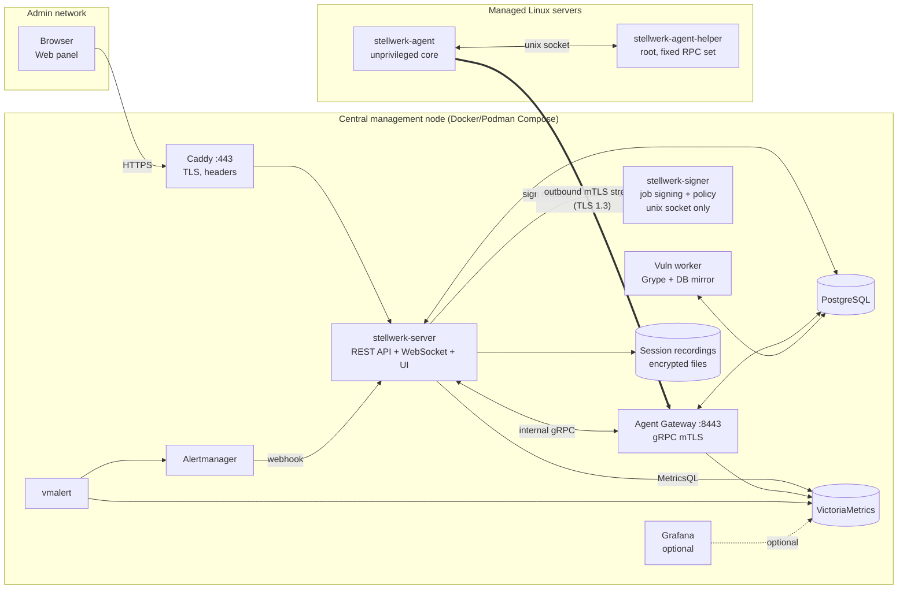

# Stellwerk — Central Linux Server Management Platform

> **Status:** Architecture baseline v0.2 (2026-11-05) — open questions decided (§12), implementation in progress
> **Working name:** *Stellwerk* (German for "signal box" — one central place that controls many tracks). Placeholder; rename freely (search/replace `stellwerk`).
> **Audience:** The implementer (Claude Code + human reviewer). This document is the source of truth for architecture decisions until superseded by an ADR in `docs/adr/`.

---

## 1. Goals and non-goals

### 1.1 Goals

| # | Goal | Measurable target |
|---|------|-------------------|
| G1 | Manage a fleet of Linux servers from one web panel | 1 central node handles ≥ 1,000 agents |
| G2 | Monitoring: CPU, RAM, disk, network, processes, services | 15 s resolution, 30 d raw retention (configurable) |
| G3 | Security checks + vulnerability management | Daily hardening checks, CVE matching on every package change |
| G4 | Update & package management | apt + dnf in MVP, security-only updates, maintenance windows, staged rollout |
| G5 | Remote shell in the browser | Recorded, MFA step-up, RBAC-scoped, no inbound ports on servers |
| G6 | **Very secure** | Compromise of the web tier must not equal root on every server (see §6) |
| G7 | **Low footprint on managed servers** | Agent: < 30 MB RSS, < 1 % of one core averaged, single static binary, zero runtime deps |
| G8 | Easy deployment | Central: one `install-central.sh`; agent: one command with enrollment token |

### 1.2 Non-goals (explicitly out of scope, at least for v1)

- **Not an EDR / XDR.** It complements an existing EDR (e.g. CrowdStrike Falcon); it can *check that the EDR sensor is running* but does no behavioral detection.
- No Windows agents in v1 (protocol must not preclude them later).
- No Kubernetes cluster management (containers on hosts are *inventoried* only).
- No multi-tenancy (single organization). Data model keeps an `org_id`-free design but host groups provide scoping.
- No full configuration-management DSL (no reinventing Ansible). Desired-state for a *small* set of things (packages, services, files hashes) only — later phase.

---

## 2. Key decisions (summary)

| Decision | Choice | Why (short) |
|----------|--------|-------------|
| Transport model | **Own lightweight agent, outbound-only connection** to central (agent dials out) | No inbound ports on managed servers; works through NAT/firewalls; central never holds SSH keys with root on everything |
| Agent ↔ central protocol | **gRPC over HTTP/2, mutual TLS (TLS 1.3 only)**, one long-lived bidirectional stream + per-session streams | Strong identity per host, multiplexing, streaming for shell & metrics, typed contracts (protobuf) |
| Web UI ↔ backend | **REST (OpenAPI 3.1) + WebSocket** (live events, terminal) | Standard, easy to test, generate TS client; WebSocket needed for xterm.js |
| SSH | **Not the core transport.** Optional later "agentless mode" for hosts where no agent may be installed | SSH push requires inbound 22, central key custody, per-host key mgmt; see §3.1 |
| Ansible | **Not used under the hood.** Optional integration later (run playbooks from central against hosts) | Python on targets, push over SSH, slow at scale, overlaps with our job system |
| Checkmk | **Not used.** | Brings its own UI/agent/config model → two systems instead of one panel |
| Metrics storage | **VictoriaMetrics single-node** (Apache-2.0) | Single binary, very low RAM/disk, PromQL-compatible (MetricsQL) |
| Logs (later) | **VictoriaLogs** (Apache-2.0) | Same family, single binary, much lighter than Elasticsearch/Loki |
| Alerting | **vmalert + Alertmanager** (Apache-2.0) + built-in state alerts | Proven rule engine; Alertmanager handles routing/dedup/silencing |
| Dashboards | **Own UI charts (uPlot)**; **Grafana optional** compose profile | One panel for operators; Grafana (AGPL-3.0, fine for internal use) for power users |
| Vulnerability matching | **Grype on central** against agent-produced **CycloneDX SBOM** | Agents stay light; Grype scans SBOMs offline once DB is downloaded |
| Hardening checks | **Built-in Go checks** (CIS-inspired subset); **Lynis** optionally invoked if installed | Built-in = deterministic, typed results; Lynis adds breadth |
| Remote access | **Own implementation** (PTY over gRPC, xterm.js) | Teleport Community Edition is not licensed for companies with ≥ 100 employees or ≥ $10M revenue (since v16) |
| PKI | **Built-in CA** (Go `crypto/x509`), root + online intermediate, short-lived agent certs | Fewer moving parts than step-ca/Vault; fully controlled lifecycle |
| Job integrity | **Ed25519-signed job envelopes** from a **separate signer process**; agent verifies + enforces local policy | Defense in depth: API compromise ≠ arbitrary root commands (§6.3) |
| Backend language | **Go** (server + agent, one repo) | Static binaries, low memory, great crypto/TLS/gRPC stdlib & ecosystem |
| Frontend | **React + TypeScript + Vite**, TanStack Query, Tailwind + shadcn/ui, xterm.js, uPlot | Large ecosystem, xterm.js first-class |
| Database | **PostgreSQL** (17+) | Relational inventory/RBAC/jobs/audit, JSONB for flexible inventory |
| Central deployment | **Docker Compose (or Podman Compose)** generated by `install-central.sh` | Easy, reproducible, upgradable; HA is a later phase |
| Front proxy | **Caddy** for web UI/API only (ACME or internal cert) | Automatic TLS, security headers; agent gateway terminates mTLS itself |

---

## 3. Build vs. reuse analysis

### 3.1 SSH-based (agentless) vs. agent-based

| Aspect | SSH push (Ansible-style) | Outbound agent (chosen) |
|--------|-------------------------|-------------------------|
| Inbound ports on servers | 22 must be reachable from central | **None** |
| Credentials at central | Private key(s) that can log in (often root/sudo) everywhere | Only a CA + job-signing key; agents additionally enforce local policy |
| Continuous monitoring | Needs polling via SSH (expensive) or a separate agent anyway | Native, push-based |
| Real-time events (agent offline, failed unit) | Poll-based | Instant (stream) |
| Footprint on target | sshd (exists) + Python for Ansible | One ~15 MB static binary |
| NAT / DMZ / segmented networks | Needs jump hosts | Works as long as host can reach central:8443 |
| Install effort | None | One-time agent install |

**Conclusion:** monitoring alone requires something resident on the host, so an agent is needed anyway. Once there is an agent, routing management through it (instead of SSH) removes the biggest risk — central SSH key custody — and the inbound port. SSH stays a possible *optional* fallback mode (Phase 6+).

### 3.2 Component-by-component

| Candidate | Verdict | Notes |
|-----------|---------|-------|
| **Ansible** | ❌ core / ⏳ optional integration | Could be offered later as "run playbook" from central (over SSH, opt-in per group), or via `ansible-pull` triggered by agent. Not on the critical path. |
| **Checkmk Community** (GPL-2.0) | ❌ | Excellent monitoring, but own UI, own agent (agent controller + shell script), config model. Would split the product. |
| **Grafana** (AGPL-3.0) | ⏳ optional | Compose profile `grafana`, pre-provisioned VictoriaMetrics datasource + dashboards; SSO via Caddy auth proxy headers. Not required. |
| **Prometheus node_exporter** | ❌ (as process) | Would be a second process + inbound scrape port. Agent embeds collectors instead (gopsutil + procfs). Agent can *optionally* expose `/metrics` on localhost for compatibility. |
| **VictoriaMetrics single** | ✅ | Storage + MetricsQL query API for the UI. Never exposed outside the compose network. |
| **vmalert + Alertmanager** | ✅ | Default rule pack shipped; Alertmanager → webhook to Stellwerk server (so alerts appear in UI) + mail/Teams/webhook receivers. |
| **VictoriaLogs** | ⏳ Phase 5 | Agent ships selected journald units / files. |
| **Grype** (Apache-2.0) | ✅ | Used as Go library or CLI on central; vulnerability DB mirrored and updated by a scheduled job; supports air-gapped DB import. |
| **Syft** | ❌ on agent | Too heavy for agent; agent builds a minimal CycloneDX SBOM directly from dpkg/rpm DB (name, version, arch, PURL with distro qualifier). |
| **Lynis** (GPL-3.0) | ⏳ optional | If `lynis` present and policy allows, agent runs `lynis audit system --cronjob` weekly, ships `/var/log/lynis-report.dat` parsed. |
| **OpenSCAP** | ⏳ Phase 6 | For formal CIS/STIG profiles on RHEL-family. |
| **osquery** | ❌ | Powerful but larger footprint; our inventory covers the needed tables. |
| **Wazuh** | ❌ | Overlapping SIEM/HIDS; server stack (indexer) is heavy. Integrate by forwarding our audit/findings to SIEM instead. |
| **Teleport** | ❌ | License restriction for larger companies (see §2); also a second access plane. |
| **step-ca / OpenBao** | ❌ MVP / ⏳ optional | Built-in CA is enough. OpenBao/HSM may later hold the job-signing key (Transit / PKCS#11). |
| **Caddy** | ✅ | TLS + headers + reverse proxy for UI/API. |
| **xterm.js, uPlot** | ✅ | Terminal and charts in UI. |
| **nfpm / GoReleaser / cosign** | ✅ | Build .deb/.rpm, release automation, signatures. |

---

## 4. System overview



The server process is one Go binary with sub-commands/roles (`server api`, `server gateway`, `server signer`, `server vuln-worker`). In Compose they run as **separate containers** from the same image so that a compromise of the internet-ish facing API process does not directly give access to the signer's key (§6.3). For tiny installs they can run in one process (`server all`) — documented as less secure.

### 4.1 Ports

| Port | Exposed to | Service |
|------|-----------|---------|
| 443/tcp | Admin network / VPN only | Caddy → web UI + REST API + WebSocket |
| 80/tcp | optional | ACME HTTP-01 + redirect (disabled when using internal CA/own cert) |
| 8443/tcp | Server networks | Agent gateway (gRPC, mTLS). Also serves `/install/*` (agent packages, install script) over **server-auth TLS only** for bootstrap |
| everything else | compose-internal network only | PostgreSQL 5432, VictoriaMetrics 8428, vmalert 8880, Alertmanager 9093, Grafana 3000 |

Managed servers need **no inbound ports** for Stellwerk.

---

## 5. Components in detail

### 5.1 Agent (`stellwerk-agent` + `stellwerk-agent-helper`)

**Privilege separation (OpenSSH-style):**

| Process | Runs as | Responsibility |
|---------|---------|---------------|
| `stellwerk-agent` (core) | dedicated user `stellwerk-agent`, systemd-sandboxed | Connection to central, metrics collection (read-only /proc, /sys), inventory reading (dpkg/rpm DB are world-readable), scheduling, job signature verification, buffering |
| `stellwerk-agent-helper` | root, socket-activated (`/run/stellwerk/helper.sock`, mode 0660, group `stellwerk-agent`) | Small, fixed RPC set: package ops, service control, reboot, PTY spawn (fd passing via `SCM_RIGHTS`), privileged checks, reading allow-listed files. **Reads local policy itself** and **re-verifies job signatures itself** — a compromised core cannot escalate beyond policy. Checks `SO_PEERCRED` uid. |

The helper is intentionally small (target < 2,000 LoC) for auditability.

**systemd hardening for core:** `NoNewPrivileges=yes`, `ProtectSystem=strict`, `ProtectHome=yes`, `PrivateTmp=yes`, `ReadWritePaths=/var/lib/stellwerk-agent`, `CapabilityBoundingSet=`, `RestrictAddressFamilies=AF_INET AF_INET6 AF_UNIX AF_NETLINK`, `SystemCallFilter=@system-service`, `MemoryMax=64M`, `CPUQuota=10%`, `LockPersonality=yes`, `RestrictSUIDSGID=yes`.

**Files on host:**

```
/usr/bin/stellwerk-agent
/usr/libexec/stellwerk/stellwerk-agent-helper
/etc/stellwerk/agent.yaml          root:root 0644   # local policy + central address + pinned CA fingerprint
/etc/stellwerk/jobkeys.d/*.pub     root:root 0644   # pinned job-signing public keys
/var/lib/stellwerk-agent/          stellwerk-agent 0700  # key, cert, spool, state
/lib/systemd/system/stellwerk-agent.service
/lib/systemd/system/stellwerk-agent-helper.{socket,service}
```

**Local policy (`/etc/stellwerk/agent.yaml`)** — cannot be changed remotely (except through a package update / config management that the host owner controls):

```yaml
central: "stellwerk.example.internal:8443"
ca_fingerprint_sha256: "AB:CD:..."      # pinned root CA
capabilities:
  metrics: true
  inventory: true
  security_checks: true
  packages: { list: true, upgrade: true, install: false, remove: false }
  services: { control: true, allow: ["nginx.service", "*.service"], deny: ["sshd.service"] }
  reboot: true
  shell: { enabled: true, allow_root: false, allowed_users: ["ops", "%sudo-ops"] }
  exec_scripts: false                  # signed scripts from library; off by default
  file_read: { allow: ["/etc/**", "/var/log/**"], deny: ["/etc/shadow", "/etc/ssl/private/**"] }
  self_update: true
limits:
  max_jobs_per_minute: 30
  max_concurrent_shells: 3
```

**Resource budget & behavior:**
- Single static Go binary (CGO disabled), amd64 + arm64. Target < 20 MB on disk, < 30 MB RSS.
- Metrics every 15 s (configurable 10–300 s), batched and **delta-friendly** protobuf, zstd-compressed.
- **Offline spool:** if central unreachable, metrics buffered on disk (ring buffer, default 50 MB / 24 h), replayed on reconnect.
- Reconnect with exponential backoff + jitter (1 s → 5 min) to avoid thundering herd after central restart.
- Inventory: full on start + every 6 h; packages re-scanned when `/var/lib/dpkg/status` or rpmdb mtime changes (inotify, debounced 60 s).
- Update check: does **not** run `apt update` by itself every few minutes — schedule configurable (default 4×/day, randomized), respects existing `unattended-upgrades`.

**Collectors (MVP):**
- CPU: per-mode usage, load1/5/15, steal, context switches, PSI (cpu/mem/io pressure) when available.
- Memory: total/available/used/cached/buffers, swap, OOM kill counter.
- Disk: per-filesystem usage + inodes; per-block-device IOPS, throughput, latency (from `/proc/diskstats`); optional SMART via `smartctl` if installed (helper).
- Network: per-interface bytes/packets/errors/drops, TCP states, conntrack usage, listening sockets count.
- System: uptime, boot time, time-sync status/offset (chrony/timesyncd), file-descriptor usage, failed systemd units, process count, top-N processes by CPU/RSS (sent every 60 s, not as metrics series).
- Local probes (configured centrally, executed by agent): TCP connect, HTTP(S) GET (status, latency, cert expiry), process-running, unit-active.

**Inventory (MVP):** OS/distro/version, kernel, virtualization type, CPU model/cores, RAM, disks/partitions/LVM, NICs/IPs/MAC/routes, DNS config, packages (name/version/arch/source repo), enabled & running systemd units, listening ports (with owning process), local users/groups (UID 0 accounts, shells, last login), sudoers summary, cron/timers, Docker/Podman containers (if socket exists), SSH host key fingerprints, local TLS certificates in common paths (expiry), installed agent version.

### 5.2 Agent Gateway (`server gateway`)

- Listens on :8443, TLS 1.3 only, `RequireAndVerifyClientCert` for the gRPC service; separate un-authenticated-client-cert listener path/ALPN only for `/install/*` and `Enroll` RPC.
- Identity = client certificate URI SAN `spiffe://stellwerk/host/<host-uuid>`; gateway checks chain, validity, **serial not in revocation denylist (in-memory, synced from DB)**, host status `active`.
- Keeps a registry of connected agents (host-id → stream). For multiple gateway replicas later: registry in PostgreSQL + `LISTEN/NOTIFY` for routing.
- Writes metrics to VictoriaMetrics via Prometheus remote-write (internal network), adds `host_id`, `hostname`, and group labels server-side (agents cannot forge labels).
- Writes inventory/results/events to PostgreSQL.
- Per-agent rate limits and message-size limits (DoS protection from a compromised host).

### 5.3 API server (`server api`)

- REST `/api/v1/...` defined **OpenAPI-first** (`api/openapi.yaml`), Go server stubs via `oapi-codegen`, TS client generated for the UI.
- WebSocket `/api/v1/events` (live host status, job progress, alerts) and `/api/v1/hosts/{id}/shell/{session}` (terminal).
- Serves the compiled UI (embedded via `go:embed`).
- AuthN, AuthZ (RBAC), audit, job orchestration, scheduling (maintenance windows, cron-like schedules), notification dispatch.
- **Never** holds the job-signing key; requests signatures from signer.

### 5.4 Signer (`server signer`)

- Separate container, **no network**, only a unix socket on a shared volume to the API container (and gateway for session grants).
- Holds Ed25519 job-signing private key (file encrypted at rest with key from env/file/TPM; later PKCS#11/HSM or OpenBao Transit).
- Before signing, independently enforces: job schema validity, max targets per job, rate limits per user, **approval requirements** (4-eyes for high-risk actions, Phase 5), and — Phase 5 hardening — verification of the requesting user's **WebAuthn assertion over the job digest** for high-risk actions. This makes a compromised API process unable to mint high-risk jobs without a real user's hardware-backed confirmation.
- Logs every signature to its own append-only log (separate from API audit).

### 5.5 Vulnerability worker (`server vuln-worker`)

- Downloads/updates the Grype vulnerability DB on schedule (or imports offline bundle for air-gapped sites).
- On SBOM change for any host (or DB update), re-matches and stores findings (CVE, severity, CVSS, EPSS if available, fixed-in version, package) in PostgreSQL.
- Correlates with package management: "fix available via upgrade" → one-click remediation job.

### 5.6 Web UI

Main areas:
1. **Dashboard** — fleet health, offline agents, active alerts, patch compliance %, critical CVEs, expiring certs.
2. **Hosts** — list w/ filters (labels, groups, OS, status), bulk actions; host detail tabs: Overview · Metrics · Inventory · Packages/Updates · Security · Services · Processes · Jobs · Shell · Audit.
3. **Updates** — fleet-wide pending updates, policies, maintenance windows, rollout rings, history.
4. **Security** — findings by check/severity, CVE view (by CVE ↔ hosts), compliance score per group, exceptions/accepted risks (with expiry + justification).
5. **Alerts** — active/silenced, rule overview.
6. **Jobs** — history, live progress, approvals queue.
7. **Admin** — users, roles, groups, enrollment tokens, agent versions/rollout, settings, audit log, certificates/keys.

Security requirements for UI: strict CSP (no inline scripts; nonce-free by bundling), `frame-ancestors 'none'`, HSTS, `SameSite=Strict` HttpOnly Secure cookies, CSRF token for state-changing requests, no secrets in localStorage.

### 5.7 Data model (PostgreSQL, initial)

```
users(id, external_id, username, display_name, email, auth_source, mfa_required, disabled, created_at)
webauthn_credentials(id, user_id, credential_id, public_key, sign_count, name, created_at)
roles(id, name, permissions[])                       -- e.g. host.view, shell.open, pkg.upgrade, admin.*
host_groups(id, name, parent_id, description)
role_bindings(id, user_id|group_claim, role_id, host_group_id NULL=global)
hosts(id uuid, hostname, fqdn, status, os_family, os_version, kernel, arch, agent_version,
      last_seen_at, enrolled_at, labels jsonb, cert_serial, cert_not_after)
host_group_members(host_id, host_group_id)
enrollment_tokens(id, token_hash, host_group_id, labels jsonb, max_uses, uses, expires_at, created_by)
agent_certs(serial, host_id, not_before, not_after, revoked_at, revoke_reason)
inventory_snapshots(host_id, kind, data jsonb, hash, collected_at)   -- latest per kind + history
host_packages(host_id, name, version, arch, source, purl)            -- normalized, latest
pending_updates(host_id, name, current, candidate, is_security, source, detected_at)
security_check_results(host_id, check_id, status, severity, evidence jsonb, collected_at)
vuln_findings(host_id, vuln_id, package, installed, fixed_in, severity, cvss, first_seen, last_seen, state)
risk_exceptions(id, scope, check_id|vuln_id, justification, expires_at, approved_by)
jobs(id, type, params jsonb, requested_by, approved_by[], status, created_at, signed_envelope bytea)
job_targets(job_id, host_id, status, started_at, finished_at, exit_code, output_ref)
schedules(id, kind, cron, timezone, params jsonb, host_group_id, enabled)
maintenance_windows(id, host_group_id, rrule, duration, timezone)
shell_sessions(id, host_id, user_id, unix_user, started_at, ended_at, recording_ref, recording_sha256)
alerts(id, fingerprint, host_id, name, severity, status, starts_at, ends_at, labels jsonb)
audit_log(id bigserial, ts, actor, actor_ip, action, target, details jsonb, prev_hash, hash)
api_tokens(id, user_id, name, token_hash, scopes[], expires_at, last_used_at)
settings(key, value jsonb)
```

Migrations with `goose`, queries with `sqlc` + `pgx`.

---

## 6. Security architecture

### 6.1 Threat model (top threats)

| ID | Threat | Impact | Primary mitigations |
|----|--------|--------|---------------------|
| T1 | Attacker compromises web/API process (RCE, auth bypass) | Could command whole fleet | Separate signer (§6.3), agent-local policy, step-up WebAuthn for high-risk jobs, agent-side rate limits, on-host local audit log |
| T2 | Stolen admin session / phished credentials | Fleet commands | OIDC + MFA mandatory, WebAuthn step-up for shell/updates/scripts, short sessions, IP allow-list option, new-device alerts |
| T3 | Rogue/compromised managed host | Pivot to central, poison data, DoS | mTLS identity bound to host; server adds labels (no label forging); strict input validation & size limits; per-host rate limits; host can only see its own jobs |
| T4 | Network MitM | Inject commands, read data | TLS 1.3 mTLS, pinned CA fingerprint in agent, signed jobs |
| T5 | Replay of old signed jobs | Repeat dangerous action | Job binds `host_id`, `job_id`, `nonce`, `not_before`, `expires_at` (default 10 min); agent keeps nonce cache until expiry |
| T6 | Malicious agent update (supply chain) | Code exec on all hosts | Releases signed with **offline release key** (separate from CA/job key), public key compiled into agent; reproducible builds; SBOM; staged rollout rings |
| T7 | Enrollment abuse (attacker enrolls fake hosts) | Data pollution, info disclosure | Single-use/short-TTL tokens, scoped to group, optional manual approval queue; enrolled hosts get no privileges toward others |
| T8 | Insider abuse of remote shell | Unauthorized changes | RBAC by host group, session recording (tamper-evident), visible on-host banner + journald entry, 4-eyes option, alerts on root shells |
| T9 | Audit log tampering | Cover tracks | Hash-chained audit log, periodic anchor export to SIEM (syslog/TLS) and on-host journald entries for every executed action |
| T10 | Secrets leakage from central (backups, DB) | Key compromise | Keys encrypted at rest; root CA key can be moved offline; backups encrypted (age); DB contains only token *hashes* |

### 6.2 PKI and keys

| Key | Algorithm | Location | Lifetime / rotation |
|-----|-----------|----------|---------------------|
| Root CA | ECDSA P-256 (or Ed25519 if all tooling OK) | Created at install, encrypted with passphrase; **can be moved offline** after intermediate is issued | 10 y |
| Agent intermediate CA | ECDSA P-256 | Gateway container (encrypted at rest) | 2 y, rotate with overlap |
| Agent client certs | ECDSA P-256, **private key generated on host, never leaves it** | `/var/lib/stellwerk-agent/` | **30 d**, auto-renew at 2/3 lifetime over existing mTLS channel |
| Gateway server cert | ECDSA P-256 | Gateway | 90 d, auto-renew |
| Job signing key | Ed25519 | Signer only | Rotation: new key announced to agents in a message signed by old key; agents keep ≤ 2 active keys |
| Release signing key | Ed25519 (minisign/cosign) | **Offline / CI secret only** | Public key compiled into agent; rotation via signed key-transition file |
| Web TLS | per Caddy (ACME / internal / own cert) | Caddy | auto |

Revocation: gateway denylist by serial (instant, since gateway is the only relying party); short cert lifetime limits exposure further.

### 6.3 Signed job envelopes (defense in depth)

```protobuf
message SignedJob {
  bytes  job     = 1;  // serialized Job (deterministic protobuf encoding)
  string key_id  = 2;
  bytes  sig     = 3;  // Ed25519("stellwerk-job-v1\x00" || job)
}
message Job {
  string job_id      = 1;  // UUIDv7
  string host_id     = 2;  // exactly one target host per envelope
  int64  not_before  = 3;
  int64  expires_at  = 4;
  bytes  nonce       = 5;  // 16 random bytes
  string requested_by = 6;
  repeated string approved_by = 7;
  oneof action {
    PkgRefresh pkg_refresh = 10;  PkgUpgrade pkg_upgrade = 11;
    ServiceAction service = 12;   Reboot reboot = 13;
    ShellGrant shell = 14;        RunCheck run_check = 15;
    RunScript script = 16;        AgentUpdate agent_update = 17;
    FileRead file_read = 18;      ProbeConfig probe_config = 19;
  }
}
```

Agent (core **and** helper) verify: signature against pinned key, `host_id == self`, time window (tolerate ±2 min clock skew, require time sync), nonce unseen, action allowed by local policy, rate limit. Every executed job is logged to the host's journald (`SYSLOG_IDENTIFIER=stellwerk-agent`) with job id + requester, giving a forensic trail outside central.

**Risk tiers:**

| Tier | Actions | Requirements |
|------|---------|--------------|
| Low | refresh package lists, run read-only checks, read allow-listed file, collect inventory | RBAC permission |
| Medium | upgrade packages, restart services, reboot | RBAC + (in maintenance window **or** step-up auth) |
| High | remote shell, run script, install/remove packages, agent policy-sensitive ops | RBAC + WebAuthn step-up (verified by signer in Phase 5) + optional 4-eyes approval per group |

### 6.4 Authentication and authorization (web)

- **Local accounts are primary in the first release** (owner decision, see ADR-0009): Argon2id password + MFA required by default (WebAuthn preferred, TOTP allowed, configurable off).
- **OIDC** (e.g. Microsoft Entra ID, Keycloak, Authentik) is a later addition; group claims → role bindings. Conditional Access/MFA enforced by IdP *and* app-level `amr`/`acr` check.
- Sessions: server-side session store (PostgreSQL), 8 h absolute / 30 min idle default; step-up valid 5 min.
- **RBAC:** permissions × scope (global or host group subtree). Built-in roles: `viewer`, `operator` (updates/services), `shell-user`, `security-analyst`, `admin`. Custom roles possible.
- API tokens: scoped, expiring, hashed (SHA-256 + server pepper), shown once; cannot open shells.
- Login rate limiting + lockout, audit of all auth events.

### 6.5 Remote shell design

1. User clicks "Shell" → UI requests session → API checks RBAC + step-up → signer issues `ShellGrant{unix_user, cols, rows, max_duration, idle_timeout, record=true}` envelope.
2. API sends grant via gateway; agent core verifies, asks helper to spawn PTY as `unix_user` (helper re-verifies grant + policy; `allow_root: false` by default — users use `sudo` with host-local rules, so sudo logging applies).
3. Helper passes PTY fd to core; core opens a **dedicated gRPC stream** `ShellSession` to gateway (separate from control stream → no head-of-line blocking).
4. Browser ⇄ WebSocket ⇄ API ⇄ gateway ⇄ agent; API tees I/O into an **asciicast v2** recording, encrypted at rest (age/XChaCha20-Poly1305), SHA-256 stored in `shell_sessions`, written to audit log.
5. On-host: message to journald + optional `wall`/MOTD-style banner "Session recorded by Stellwerk, user X".
6. Limits: max concurrent sessions per host/user, idle timeout (15 min), max duration (4 h), kill switch in UI.

Identity mapping options (per host group): (a) shared account e.g. `ops`; (b) per-user account derived from OIDC claim (`preferred_username` sanitized); agent can optionally auto-create per-user account with no password (Phase 5).

### 6.6 Central hardening

- Containers run as non-root, read-only root FS, `cap_drop: [ALL]`, `no-new-privileges`, separate internal networks (`frontend`, `backend`, `signer` socket volume only).
- Images pinned by digest; Renovate for updates; Trivy/Grype scan in CI.
- PostgreSQL: SCRAM auth, not published; daily `pg_dump` → encrypted with `age` → retention policy.
- Secrets generated by installer into `/opt/stellwerk/secrets/` (0600), mounted as files, never in env vars where avoidable.
- Audit/syslog forwarding (RFC 5424 over TLS) to SIEM.

### 6.7 Compliance mapping (useful for ISO/IEC 27001:2022 Annex A)

| Control | How Stellwerk supports it |
|---------|---------------------------|
| A.8.2 Privileged access rights | RBAC per host group, step-up auth, 4-eyes for high-risk jobs |
| A.8.5 Secure authentication | OIDC + MFA, WebAuthn |
| A.8.8 Management of technical vulnerabilities | SBOM + CVE matching, remediation jobs, risk exceptions with expiry |
| A.8.9 Configuration management | Inventory, hardening checks, drift detection (Phase 5) |
| A.8.15 Logging / A.8.16 Monitoring | Hash-chained audit log, SIEM export, metrics & alerts |
| A.8.19 Installation of software on operational systems | Package install/remove gated by policy and approvals |
| A.8.32 Change management | Maintenance windows, rollout rings, job history and approvals |

---

## 7. Feature specs

### 7.1 Security checks (built-in, MVP set)

Each check: `id`, `title`, `severity`, `rationale`, `remediation`, returns `pass|fail|warn|na|error` + evidence.

| ID | Check |
|----|-------|
| SSH-001..010 | sshd effective config (`sshd -T` via helper): PermitRootLogin, PasswordAuthentication, KbdInteractive, MaxAuthTries, X11Forwarding, allowed ciphers/MACs/KEX, LoginGraceTime |
| ACC-001 | Accounts with UID 0 other than root |
| ACC-002 | Accounts with empty password hash (helper reads `/etc/shadow`, returns only flags, never hashes) |
| ACC-003 | `NOPASSWD: ALL` sudo rules |
| ACC-004 | Interactive accounts without login for > 90 d |
| PKG-001 | Pending security updates (count / age) |
| PKG-002 | Reboot required (kernel/libc updated) and services needing restart |
| PKG-003 | Unattended security updates configured |
| NET-001 | Listening services on non-loopback (diff against baseline/allow-list) |
| NET-002 | Host firewall active (nftables/firewalld/ufw) |
| KRN-001 | sysctl hardening (`kernel.kptr_restrict`, `net.ipv4.conf.*.rp_filter`, `fs.protected_*`, `kernel.unprivileged_bpf_disabled`, …) |
| FS-001 | World-writable files in system paths, SUID/SGID binaries diff vs. package-owned |
| FS-002 | `/tmp`, `/var/tmp` mount options (nodev,nosuid) |
| SVC-001 | Required services running (configurable: e.g. EDR sensor, chrony, auditd) |
| SVC-002 | Failed systemd units |
| TIME-001 | Time synchronized |
| LOG-001 | auditd/journald persistence configured |
| CRT-001 | Local TLS certificates expiring < 30 d |
| MAC-001 | SELinux enforcing / AppArmor enabled |
| AGT-001 | Agent version outdated |

Results feed a **compliance score** per host/group; checks can be disabled per group; accepted risks via `risk_exceptions`.

### 7.2 Update & package management

- Backends: `apt` (Debian/Ubuntu), `dnf` (RHEL/Alma/Rocky/Fedora) in MVP; `zypper`, `apk` later. Implemented in helper behind interface:
  ```go
  type PackageManager interface {
      Refresh(ctx) error
      ListUpgrades(ctx) ([]Upgrade, error)      // incl. IsSecurity
      Upgrade(ctx, UpgradeSpec) (Result, error)  // all | security | named
      Install(ctx, []string) (Result, error)
      Remove(ctx, []string) (Result, error)
      Hold(ctx, []string, bool) error
      RebootRequired(ctx) (bool, []string, error)
  }
  ```
  - Security classification: apt — candidate from a `*-security` origin (via `apt-get -s` + policy parsing / python-apt-free approach); dnf — `dnf updateinfo list --security`.
  - Always non-interactive (`DEBIAN_FRONTEND=noninteractive`, `-o Dpkg::Options::=--force-confold`), output captured and streamed.
  - Lock handling (dpkg lock wait w/ timeout), conflict with running unattended-upgrades detected.
- **Patch policies** (per host group): schedule (maintenance window RRULE + timezone), scope (security only / all), auto-reboot (never / if required / always) with pre-reboot drain hook, **rollout rings** (canary → ring 1 → ring 2), **halt conditions** (agent doesn't reconnect within N min after reboot, failed units increased, probe fails) → pause rollout + alert.
- Pre/post hooks: signed scripts from library (Phase 5), e.g. take VM snapshot via hypervisor API, drain from load balancer.
- Optional: central apt/dnf caching proxy (apt-cacher-ng) as compose profile to save bandwidth — Phase 6.

### 7.3 Monitoring & alerting

- Metric names follow Prometheus conventions, prefixed `stellwerk_` (e.g. `stellwerk_cpu_seconds_total{mode=…}`), mapped to node_exporter-like semantics so community dashboards are easy to adapt.
- Default alert rules (vmalert): host down (no heartbeat 2 min — *state alert from gateway*, not metrics), CPU > 90 % 15 min, memory available < 10 %, disk > 85 %/95 %, inode > 90 %, disk will fill in 24 h (`predict_linear`), high iowait, NIC errors, systemd unit failed, time offset > 1 s, cert expiry < 14 d, critical CVE with fix available > 7 d.
- Receivers: email (SMTP), Microsoft Teams / Slack webhook, generic webhook, (later) PagerDuty/Opsgenie.

### 7.4 Other features (backlog, prioritized in §9)

Service control · process list/kill · file browser & transfer (read-mostly, size-limited, audited) · scripts library (versioned, signed, parameterized) · bulk actions over groups/labels · scheduled jobs · config drift (tracked file hashes) · SSH authorized_keys management · user/account lock · reports (patch compliance, CVE exposure; CSV/PDF) · REST API + CLI `stellwerkctl` · log shipping to VictoriaLogs · agentless SSH mode · Ansible integration · HA central.

---

## 8. Deployment

### 8.1 Central: `install-central.sh`

Supported hosts: Debian 12/13, Ubuntu 24.04, RHEL/Alma/Rocky 9/10. Minimum sizing: 2 vCPU / 4 GB RAM / 50 GB disk for ~200 hosts; 4 vCPU / 8 GB / 200 GB for ~1,000 hosts.

Flow (idempotent; `--non-interactive` with flags/env for automation):

1. Preflight: root, OS, CPU arch, RAM/disk, ports 443/8443 free, time sync, DNS for FQDN.
2. Install Docker Engine + compose plugin (or use existing Podman) from distro/vendor repo.
3. Prompt/flags: `--fqdn`, `--tls acme|internal|custom --cert --key`, `--agent-endpoint` (may differ from UI FQDN), `--oidc-issuer/--oidc-client-id/--oidc-client-secret` (optional), `--admin-email`, retention.
4. Create `/opt/stellwerk/{compose.yml,Caddyfile,.env,secrets/,data/,backups/}` with strict permissions; generate DB passwords, session keys, encryption keys (`openssl rand`).
5. Pull images **by digest** (or load from offline tarball `--offline bundle.tar.zst`); verify cosign signatures.
6. `docker compose run --rm server init` → DB migrations, root CA + intermediate + gateway cert, job-signing key, break-glass admin with **one-time password** + forced WebAuthn enrollment on first login.
7. `docker compose up -d`; health checks; print: UI URL, CA fingerprint, first enrollment command.
8. Install systemd timer for encrypted backups; helper scripts `stellwerk-backup`, `stellwerk-restore`, `stellwerk-upgrade` (pull new digests, backup, migrate, restart, rollback on failed health check).
9. Optional host firewall rules (nftables) restricting 443 to admin CIDRs.

### 8.2 Agent install

Command block shown in UI (root CA PEM, script hash and token pre-filled). The CA is passed explicitly so `curl` verifies the gateway against the internal CA — **never `-k`**:

```bash
cat > /tmp/stellwerk-ca.pem <<'EOF'
-----BEGIN CERTIFICATE-----
…root CA, rendered by UI…
-----END CERTIFICATE-----
EOF
curl -fsS --proto '=https' --tlsv1.3 --cacert /tmp/stellwerk-ca.pem \
     -o /tmp/stellwerk-install.sh https://stellwerk.example.internal:8443/install/agent.sh \
  && echo "<sha256>  /tmp/stellwerk-install.sh" | sha256sum -c - \
  && printf '%s' 'swk_enr_…' | sudo sh /tmp/stellwerk-install.sh --token-stdin
```

The token is read from stdin (not argv) so it doesn't show up in `ps`; it is also single-use or short-TTL, so leakage via shell history has limited value.

Script: detect distro/arch → download `.deb`/`.rpm` from central → verify signature with embedded release public key → install → write `/etc/stellwerk/agent.yaml` (central, CA fingerprint, default policy) → `stellwerk-agent enroll --token …` → agent generates key pair locally, sends CSR + host facts, receives cert + job public keys → enable & start units.

Mass rollout alternatives: native package repository served by central (`/install/repo/{apt,rpm}`) for use with existing config management, cloud-init snippet, golden-image mode (install without token; enroll on first boot via token in metadata).

Uninstall: `stellwerk-agent unenroll` (revokes cert centrally if reachable) + package removal; host marked `decommissioned`.

### 8.3 Agent self-update

Central publishes target version per ring; agent downloads package from gateway, verifies release signature, installs via helper (`dpkg -i`/`rpm -U`), systemd restarts; if new agent does not reconnect within 5 min, a watchdog timer in the package rolls back to previous version (kept in `/var/lib/stellwerk-agent/rollback/`).

---

## 9. Roadmap (implementation phases)

Each phase ends with: tests green, docs updated, demo on ≥ 3 VMs (Debian 13, Ubuntu 24.04, Rocky/Alma 9).

### Phase 0 — Foundations (repo & contracts)
- Monorepo layout (§10), Go module, `buf` for protobuf, `api/openapi.yaml` skeleton, Makefile/Taskfile.
- CI: `go vet`, `golangci-lint`, `gosec`, `govulncheck`, unit tests, frontend lint/test, image build, SBOM.
- Dev environment: `deploy/dev/compose.yml` + 3 Incus/LXD or Vagrant test VMs.
- ADRs 0001–0008 written from §2.
- **Exit:** `make dev` brings up empty stack; CI green.

### Phase 1 — MVP core: connect, see, measure
- Built-in CA, `server init`, enrollment tokens, `Enroll` RPC, mTLS stream, heartbeats, reconnect/backoff, cert renewal, revocation denylist.
- Agent core collectors (CPU/mem/disk/net/system), offline spool, remote-write to VictoriaMetrics.
- Inventory (OS, hardware, packages, units, ports, users) → PostgreSQL.
- Web: local login (Argon2id + WebAuthn/TOTP), host list, host detail (overview, metrics charts, inventory), enrollment token UI.
- `install-central.sh` (online mode), agent install script + `.deb`/`.rpm` via nfpm.
- **Exit:** install central on fresh VM with one command, enroll 3 hosts with one command each, see live charts; agent RSS < 30 MB.

### Phase 2 — Jobs, packages, audit
- Signer process, signed envelopes, agent + helper verification, local policy enforcement, nonce cache, on-host journald logging.
- Helper with apt + dnf backends; list/refresh/upgrade (all/security/named), reboot, service control.
- Job framework (fan-out, progress streaming, cancel, timeouts), job history UI, fleet "Updates" view.
- Hash-chained audit log + UI + syslog export.
- **Exit:** security-only upgrade across a group from UI with live output; tampered/replayed envelope rejected (test).

### Phase 3 — Remote shell, SSO, RBAC
- ShellGrant flow, PTY via helper, dedicated stream, xterm.js, recordings (encrypted asciicast) + playback UI.
- OIDC login, group-claim mapping, RBAC permissions × host-group scopes, step-up auth.
- **Exit:** shell works through NAT, recorded, playback works; user without permission on group cannot open shell (test).

### Phase 4 — Security & alerting
- Built-in checks (§7.1), compliance score, risk exceptions.
- SBOM generation on agent, vuln-worker with Grype, CVE views, "fix available" remediation.
- vmalert + Alertmanager with default rules, UI alerts, notification receivers.
- Optional Lynis integration.
- **Exit:** intentionally weakened VM shows expected findings; known-vulnerable package version shows CVE with fix.

### Phase 5 — Operations at scale & hardening tier
- Patch policies: maintenance windows, rollout rings, halt conditions, auto-reboot.
- Agent self-update with rollback.
- WebAuthn-over-job-digest verified by signer; 4-eyes approvals.
- Scripts library (signed), file browser/transfer, process view, config drift.
- VictoriaLogs log shipping; reports; `stellwerkctl` CLI; offline/air-gapped install bundle.

### Phase 6 — Optional/extended
- HA central (PostgreSQL replication, multiple gateways, VM cluster), OpenSCAP profiles, agentless SSH mode, Ansible integration, zypper/apk backends, caching proxy, Grafana SSO profile, external secret store (OpenBao/HSM).

---

## 10. Repository layout

```
stellwerk/
├── CLAUDE.md
├── README.md
├── go.mod
├── Makefile                      # or Taskfile.yml
├── api/
│   └── openapi.yaml              # REST contract (source of truth)
├── proto/stellwerk/agent/v1/     # gRPC contracts (buf)
│   ├── gateway.proto             # Enroll, Connect (bidi), ShellSession, Renew
│   ├── job.proto                 # SignedJob, Job, actions
│   ├── metrics.proto
│   └── inventory.proto
├── cmd/
│   ├── stellwerk-server/         # roles: api | gateway | signer | vuln-worker | all | init | migrate
│   ├── stellwerk-agent/          # run | enroll | unenroll | status | check-config
│   ├── stellwerk-agent-helper/
│   └── stellwerkctl/
├── internal/
│   ├── common/                   # envelope (sign/verify), ids, version, logging, config
│   ├── pki/                      # CA, CSR handling, cert renewal
│   ├── server/
│   │   ├── api/                  # REST handlers (generated + impl), websocket
│   │   ├── auth/                 # sessions, OIDC, local, webauthn, stepup
│   │   ├── rbac/
│   │   ├── gateway/              # agent registry, stream handling, remote-write
│   │   ├── signer/
│   │   ├── jobs/                 # orchestration, scheduling, rollout
│   │   ├── shell/                # session broker, recording
│   │   ├── inventory/
│   │   ├── security/             # check results, scoring, exceptions
│   │   ├── vuln/                 # grype integration
│   │   ├── alerts/               # alertmanager webhook, state alerts, notify
│   │   ├── audit/
│   │   └── store/                # sqlc queries, migrations (goose)
│   ├── agent/
│   │   ├── conn/                 # gRPC client, backoff, spool
│   │   ├── collect/              # metrics collectors
│   │   ├── inventory/
│   │   ├── checks/               # security checks
│   │   ├── sbom/
│   │   ├── policy/
│   │   ├── jobs/                 # verify + dispatch
│   │   ├── shell/
│   │   └── helperclient/
│   └── helper/                   # privileged RPC server, pkg backends (apt, dnf), pty, services
├── web/                          # React + TS + Vite
├── deploy/
│   ├── install-central.sh
│   ├── agent-install.sh.tmpl
│   ├── compose/                  # compose.yml, Caddyfile, vmalert rules, alertmanager.yml
│   ├── packaging/                # nfpm.yaml, systemd units, postinst scripts
│   └── dev/
├── docs/
│   ├── ARCHITECTURE.md
│   ├── adr/
│   ├── SECURITY.md               # threat model details, disclosure policy
│   └── runbooks/
└── test/
    ├── integration/              # testcontainers (postgres, victoriametrics)
    └── e2e/                      # VM-based (Incus/Vagrant), Playwright for UI
```

---

## 11. Testing strategy

- **Unit:** envelope signing/verification (incl. negative cases: wrong host, expired, replay, wrong key, truncated), policy evaluation, parsers (apt/dnf output, /proc), RBAC matrix.
- **Fuzzing:** Go native fuzzing for protobuf handlers at gateway, apt/dnf output parsers, policy parser.
- **Integration:** testcontainers for PostgreSQL + VictoriaMetrics; gateway ↔ agent in-process with real TLS.
- **E2E:** VM matrix (Debian 12/13, Ubuntu 22.04/24.04, Alma/Rocky 9, amd64 + arm64 where possible); Playwright for UI flows (login, enroll, upgrade, shell).
- **Security:** `gosec`, `govulncheck`, dependency review, container scan, ZAP baseline against UI in CI, manual pentest before first production use.
- **Performance:** agent RSS/CPU benchmark in CI (fail if > budget); load test gateway with 2,000 simulated agents (`cmd/stellwerk-loadgen`).

---

## 12. Decisions on the former open questions (2026-11-05)

| # | Question | Decision | Consequence in the design |
|---|----------|----------|---------------------------|
| 1 | Scale | **~10 servers** | Single-node central is ample; HA stays in **Phase 6**. Default sizing 2 vCPU / 4 GB. |
| 2 | Distros / air-gap | **RHEL-family and Debian/Ubuntu**, no air-gapped segments | apt + dnf backends only (zypper/apk stay Phase 6); online install path is primary, offline bundle remains optional. |
| 3 | IdP | **No IdP integration at first; local accounts** on the management server | ADR-0009: local accounts are primary (Argon2id + MFA required by default, WebAuthn preferred, TOTP allowed). Schema keeps `external_id`/`auth_source` for later OIDC. |
| 4 | Shell identity / root | **All configurable** | Fleet default + per-host-group override: `shared` account, `per_user` (Stellwerk username), or `choose`. Root requires central `allow_root` (fleet *and* group) **and** the `shell.root` permission **and** `allow_root: true` in the host's local policy. Default: `choose`, shared account `ops`, root off. |
| 5 | Retention | **Metrics 30 d, audit ≥ 1 y, recordings 90 d** | Defaults: metrics 30 d (VictoriaMetrics `-retentionPeriod`), audit 400 d (UI enforces ≥ 365), recordings 90 d, job output 90 d; hourly retention job. |
| 6 | Notifications | **Mail and webhook, both optional** | ADR-0010: Alertmanager forwards to Stellwerk; Stellwerk delivers to SMTP and HMAC-signed HTTPS webhooks configured in the UI. |
| 7 | Placement / ports | **No restrictions** | 443 is not restricted by default; `install-central.sh --admin-cidrs` can still add an nftables restriction. Agents need only 8443 outbound. |
| 8 | License / naming | **Internal only, open source later** | No license file yet (packages say "Proprietary (internal)"); all dependencies are OSI-licensed (Apache-2.0/MIT/BSD; Grafana AGPL only as optional profile) so open-sourcing stays possible. Working name *Stellwerk* kept; repository is *LibreManager*. |

### 12.1 Implementation notes (refinements, no change of intent)

- **OpenAPI 3.0.3** instead of 3.1 for full generator support (oapi-codegen, openapi-typescript); semantics identical.
- **Job actions**: besides §6.3, `PkgInstall`, `PkgRemove` and `CollectInventory` exist as separate actions. `CancelJob` is not signed: it can only stop work, never start it.
- **Job dispatch** goes through PostgreSQL (`job_targets` + `LISTEN/NOTIFY`), which also prepares multiple gateways; the API ↔ gateway control channel (shell relay, cancel) is gRPC on a unix socket.
- **Helper ↔ core**: length-prefixed protobuf over the unix socket with `SO_PEERCRED`; the helper re-reads the root-owned policy, `/etc/stellwerk/host-id` and pinned keys for every job and keeps its own persistent nonce cache. It checks time sync before signature verification so an unsynced clock does not consume nonces.
- **Agent sandbox**: `ProtectHome=read-only` (instead of `yes`) so `/home` filesystem usage stays measurable; `SystemCallFilter=@system-service adjtimex` because the time-sync check needs a read-only `adjtimex`; `ProtectClock` is not set for the same reason.
- **Package refresh**: the agent never refreshes package metadata on its own (no unsigned path); listings use the distribution's own refresh timers (`apt-daily`, `dnf-makecache`) or a signed `pkg_refresh` job.
- **SBOM**: the agent reports a package list with PURLs (name, version, arch, source package, distro qualifier); the CycloneDX SBOM for Grype is assembled centrally from it (Phase 4).

## 13. Glossary

- **Agent core / helper** — unprivileged main agent process / small root process with fixed operations.
- **Envelope** — signed job message verified by agent.
- **Ring** — rollout stage for updates (canary → broad).
- **Step-up** — fresh strong authentication (WebAuthn) before a high-risk action.
